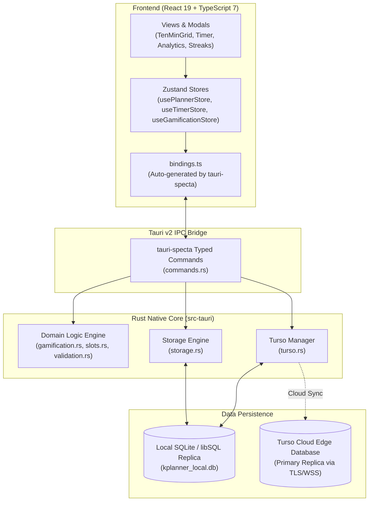

# K-Planner ("Dreamy Study")

[](https://github.com/betzadev/kplanner/actions)
[](https://v2.tauri.app/)
[](https://react.dev/)
[](https://www.typescriptlang.org/)
[](https://www.rust-lang.org/)
[](https://turso.tech/)
[](https://tailwindcss.com/)
[](https://github.com/pmndrs/zustand)
[](https://vitejs.dev/)

**K-Planner** is a clean, colorful, and minimalist study planner designed for mobile (Android) and desktop platforms. Inspired by aesthetic Korean study culture (*Studygram*), it combines the structured 10-minute visual study grid with a precision Pomodoro focus timer, automatic task forwarding, D-Day exam countdowns, Duolingo-style streak gamification, and ambient white noise audio.

The application operates with an **offline-first** architecture: all records write directly to an embedded local SQLite database running via Rust, syncing automatically with [Turso (libSQL)](https://turso.tech/) in the background whenever an internet connection is available.

---

## Table of Contents

1. [Technology Stack](#technology-stack)
2. [Project Architecture](#project-architecture)
3. [Key Features](#key-features)
4. [Project Structure](#project-structure)
5. [Getting Started](#getting-started)
   - [Prerequisites](#prerequisites)
   - [Installation & Setup](#installation--setup)
   - [Running in Development](#running-in-development)
   - [Building for Production](#building-for-production)
6. [Development Workflow](#development-workflow)
7. [Coding Standards](#coding-standards)
8. [Testing](#testing)
9. [Contributing](#contributing)
10. [License](#license)

---

## Technology Stack

| Component / Tool | Version | Category / Role |
| :--- | :--- | :--- |
| **Rust** | `1.99.1` | Native backend (Edition 2021) |
| **Tauri** | `2.12.4` | Desktop & Mobile hybrid bridge (CLI `^2`) |
| **React** | `19.3.0` | UI Component library |
| **TypeScript** | `7.0` | Strict type system (`noUncheckedIndexedAccess`) |
| **Vite** | `8.3.5` | Frontend bundler & dev server (`es2022`) |
| **Tailwind CSS** | `4.3.3` | Styling engine via `@tailwindcss/vite` |
| **Zustand** | `5.0.15` | Modular state management |
| **libSQL** | `0.9.30` | Embedded Turso database with replication |
| **rusqlite** | `0.40.2` | Local SQLite driver |
| **Node.js** | `24 LTS` | Runtime environment |
| **pnpm** | `12.15` | Package manager |
| **Android NDK** | `27.2.12479018` | NDK r27c LTS mobile compiler |

---

## Project Architecture

K-Planner utilizes an **offline-first hybrid architecture**. The React interface communicates with the Rust native core via Tauri's typed IPC generated by `tauri-specta`. All mutations are committed to local SQLite / libSQL and synchronized to Turso Cloud when online.



### Tauri Native Commands

| Command | Signature | Description |
| :--- | :--- | :--- |
| `compute_streak` | `(profile, sheets, today) -> Result<StreakResult, String>` | Computes consecutive study streak, today's minutes, and 7-day study history |
| `compute_xp_gain` | `(action, multiplier: Option<f32>) -> Result<u32, String>` | Computes action XP rewards with optional milestone multiplier |
| `apply_streak_freeze` | `(profile, date) -> Result<GamificationProfile, String>` | Consumes streak freeze protection safely |
| `build_day_slots` | `(date) -> Result<Vec<Slot>, String>` | Generates 144 pre-calculated 10-minute slot boundaries for the 24-hour grid |
| `validate_daily_sheet` | `(sheet) -> Result<(), String>` | Validates study duration range and nested task limits via `validator` |
| `compute_dday_remaining` | `(event, now) -> Result<DDayStatus, String>` | Strict ISO date parsing and countdown calculation |

### Data Synchronization Flow
1. **Local Commit:** When a user checks a task or records a 10-minute block, the change is committed instantly to local SQLite via Tauri IPC (`save_daily_sheet`, `save_gamification_profile`).
2. **Replication Trigger:** The `TursoManager` checks connectivity (`navigator.onLine`) and pushes local frames to the remote Turso database via `db.sync()`.
3. **Rehydration:** On application launch, state is rehydrated from SQLite into Zustand stores, falling back to cached state if SQLite is initializing.

---

## Key Features

- **Korean 10-Minute Study Grid (TenMinGrid):**
  - Continuous 24-hour visual study tracker with 10-minute slot granularity.
  - Dual Touch Interaction: Toggle between **Paint Mode** (swipe across cells to record study sessions) and **Scroll Mode** (pan across the day smoothly).
  - Subject-specific pastel color assignment with instant visual feedback.

- **Precision Pomodoro Focus Timer:**
  - Configurable focus, short break, and long break intervals with phase navigation buttons.
  - Background-accurate clock synchronization utilizing `visibilitychange` to prevent mobile timer throttling.
  - Procedural Web Audio API sound generator for Ambient Noise (Brown Noise, Pink Noise, Soft Rain) without external asset overhead.
  - Native Android Screen Wake Lock integration (`navigator.wakeLock`) during active study.

- **Gamification & Rewards Engine:**
  - Duolingo-style streak counter with XP progression, milestone multipliers, and streak freeze protections.
  - Daily completion stamps with customizable ink colors.
  - Gem economy for unlocking custom themes and chime sounds.
  - Persisted across devices via local SQLite and Turso cloud synchronization.

- **Exam & D-Day Countdown Tracker:**
  - Multi-event countdown tracker with custom icons and urgency color cues.
  - Integrated into daily sheet headers for persistent focus.

- **Detailed Study Analytics:**
  - 24-hour distribution column charts showing peak focus hours.
  - Subject distribution donut charts and weekly comparative progress bars.
  - 12-month annual study heatmap.

- **Studygram 9:16 Social Share Card:**
  - High-resolution card export optimized for Instagram Stories and social sharing.
  - Native Web Share API integration (`navigator.share`) with multi-tier fallback for Android WebViews.

- **Native Android Experience:**
  - Hardware back button and gesture navigation support (`useBackButton`).
  - Haptic touch feedback on actions and timer completions.
  - Ultra-lightweight APK footprint (<15 MB per ABI) and Google Play App Bundle (AAB).

---

## Project Structure

```
kplanner/
├── .github/
│   ├── scripts/
│   │   ├── audit-apk.py           # Deep size inspection and category breakdown
│   │   └── patch-gradle.py        # Automated R8, language filtering & ProGuard injection
│   └── workflows/
│       └── build-apk.yml          # Dual CI/CD pipeline (Debug Smoke + Release per ABI)
├── public/                        # Static web assets & icons
├── src/
│   ├── assets/                    # Shared vector assets
│   ├── components/
│   │   ├── analytics/             # 24h charts, subject distribution, yearly heatmap
│   │   ├── gamification/          # Streak modal, gem store, achievements
│   │   ├── planner/               # 10-min grid, checklist, D-Day, routines, share card
│   │   ├── settings/              # Cloud sync, themes, storage management
│   │   ├── timer/                 # Pomodoro countdown, ambient noise, controls
│   │   └── ui/                    # Reusable atomic UI elements (GridCell, Modal, etc.)
│   ├── hooks/                     # Custom React hooks (useBackButton, useStudyTimer)
│   ├── services/                  # Tauri IPC abstraction layer (tauriApi.ts)
│   ├── store/                     # Zustand state management stores
│   ├── types/                     # Shared TypeScript interfaces & models
│   ├── utils/                     # Ambient audio, wake lock, date & slot mappers
│   ├── App.tsx                    # Root application component & layout
│   └── main.tsx                   # React 19 entrypoint
├── src-tauri/
│   ├── icons/                     # Multi-platform app icon sets
│   ├── src/
│   │   ├── commands.rs            # Tauri IPC command definitions
│   │   ├── lib.rs                 # Tauri application builder & plugin setup
│   │   ├── main.rs                # Native binary entrypoint
│   │   ├── models.rs              # Serde data structs (DailySheet, DDayEvent, etc.)
│   │   ├── storage.rs             # Local SQLite database engine & automated tests
│   │   └── turso.rs               # Turso edge replication manager
│   ├── Cargo.toml                 # Rust dependencies & release profile (opt-level="z")
│   ├── proguard-rules.pro         # ProGuard/R8 keep rules for Tauri JNI bridge
│   └── tauri.conf.json            # Tauri v2 bundle, window & permission configuration
├── package.json                   # Project scripts and dependencies
├── tsconfig.json                  # Strict TypeScript configuration
└── vite.config.ts                 # Vite 8 build & Rollup chunking configuration
```

---

## Getting Started

### Prerequisites

Ensure you have the following installed on your development workstation:
- **Node.js**: `v22.0.0` or higher
- **pnpm**: `v10.0.0` or higher
- **Rust**: `v1.85.0` or newer with `cargo` and `rustup`
- **Tauri Prerequisites:** Follow the [Tauri v2 Prerequisites Guide](https://v2.tauri.app/start/prerequisites/) for your operating system.
- *(For Android compilation)*:
  - Java JDK 17 (Zulu distribution recommended)
  - Android SDK (API 34/35) & Android NDK 27 (`27.2.12479018`)
  - Rust Android targets: `rustup target add aarch64-linux-android armv7-linux-androideabi`

### Installation & Setup

1. **Clone the repository:**
   ```bash
   git clone https://github.com/betzadev/kplanner.git
   cd kplanner
   ```

2. **Install frontend dependencies:**
   ```bash
   pnpm install
   ```

3. **Configure Environment Variables (Optional for Turso Cloud Sync):**
   Create a `.env` file in the root directory:
   ```env
   TURSO_DATABASE_URL=libsql://your-database-name.turso.io
   TURSO_AUTH_TOKEN=your-turso-jwt-token
   ```

### Running in Development

- **Run in Desktop Mode (Tauri Window):**
  ```bash
  pnpm tauri dev
  ```
- **Run Frontend Only (Browser Mode):**
  ```bash
  pnpm dev
  ```
- **Run on Connected Android Device / Emulator:**
  ```bash
  pnpm tauri android dev
  ```

### Building for Production

- **Build Web Frontend:**
  ```bash
  pnpm build
  ```
- **Build Desktop Application (Linux / Windows / macOS):**
  ```bash
  pnpm tauri build
  ```
- **Build Optimized Android Release APKs by ABI:**
  ```bash
  # arm64-v8a (Modern mobile devices)
  pnpm tauri android build --apk --target aarch64

  # armeabi-v7a (Legacy 32-bit mobile devices)
  pnpm tauri android build --apk --target armv7
  ```
- **Build Android App Bundle (Google Play Store):**
  ```bash
  pnpm tauri android build --aab --target aarch64 --target armv7
  ```

---

## Development Workflow

### Branching Strategy
- `main`: Production-ready releases. Protected branch; merges occur via tested pull requests.
- `develop`: Active integration branch. All features, UI polishes, and bug fixes are merged here first.
- Feature branches: `feat/<feature-name>`, `fix/<issue-name>`.

### CI/CD Pipeline (`.github/workflows/build-apk.yml`)
The GitHub Actions workflow runs on every push to `main` and `develop` and supports manual dispatch (`workflow_dispatch`):
1. **`build-debug-smoke`**: Rapid compilation of a universal debug APK to detect regressions in frontend build, Rust compilation, and Tauri initialization.
2. **`build-release-abi`**: Full production pipeline that:
   - Compiles Rust with size-optimized flags (`opt-level = "z"`, `lto = true`, `strip = "symbols"`).
   - Injects R8 minification, resource shrinking, and language filters (`en`, `es`, `ko`).
   - Produces signed release APKs per ABI (`arm64-v8a`, `armeabi-v7a`) and release AAB bundles.
   - Executes `audit-apk.py` to publish size breakdowns and top 20 heaviest files to `$GITHUB_STEP_SUMMARY`.

---

## Coding Standards

### TypeScript & React
- **Functional Components:** All components use React functional syntax with typed props (`React.FC<Props>` or explicit interface parameters).
- **Zustand Selectors:** Access store properties via granular selectors (e.g. `const tasks = usePlannerStore((state) => state.tasks)`) to avoid unnecessary re-renders.
- **Strict Typing:** No `any` types; all IPC payloads and domain models match between TypeScript interfaces ([`src/types/index.ts`](file:///home/betza/Documentos/kplanner/src/types/index.ts)) and Rust structs ([`src-tauri/src/models.rs`](file:///home/betza/Documentos/kplanner/src-tauri/src/models.rs)).
- **Tree-Shaking:** Import icons directly as named imports (e.g. `import { Flame, Play } from 'lucide-react'`).

### Rust & Backend
- **Safe Concurrency:** Error trait objects across asynchronous tasks must satisfy `Send + Sync + 'static`.
- **Idiomatic Error Handling:** Avoid `.unwrap()` or `.expect()` in production paths; use `Result<T, String>` for all Tauri commands.
- **Idempotent Storage:** All database upserts use `INSERT INTO ... ON CONFLICT DO UPDATE` to guarantee idempotent data replication.

---

## Testing & Quality Assurance

### Rust Backend Tests (15 unit tests)
```bash
cargo test --manifest-path src-tauri/Cargo.toml
```
Coverage includes:
- **Gamification:** `test_streak_consecutive_days`, `test_streak_broken_by_gap`, `test_streak_freeze_consumed`, `test_streak_xp_milestone_multiplier`.
- **Slots:** `test_build_day_slots_returns_144`, `test_slot_boundaries_align_to_ten_minutes`.
- **Validation & D-Day:** `test_validate_sheet_rejects_excessive_minutes`, `test_dday_remaining_zero_on_event_day`, `test_dday_remaining_negative_after_past`, `test_dday_remaining_fails_on_invalid_date`.
- **Models:** `test_subject_item_roundtrip`, `test_timer_config_defaults`.
- **Storage & Turso:** `test_schema_initialization`, `test_idempotent_daily_sheet_upsert`, `test_dday_crud_and_gamification_profile`.

### TypeScript Strict Validation
```bash
pnpm types:gen
pnpm exec tsc --noEmit
pnpm build
```
Enforces `strict: true`, `noUncheckedIndexedAccess: true`, `noUnusedLocals: true`, `noUnusedParameters: true`, and `exactOptionalPropertyTypes: true` with 0 errors.

### Technical Debt Status
- [x] **SubjectItem & TimerConfig:** Migrated to Specta type definitions.
- [x] **Branded Types:** Isolated in `src/types/branded.ts` with explicit adapters.
- [ ] **Legacy Component Props:** Minor optional property type alignments in legacy modals under `exactOptionalPropertyTypes`.

---

## Contributing

Contributions are welcome! Please follow these steps:

1. **Fork the repository** and create a descriptive branch:
   ```bash
   git checkout -b feat/my-new-feature
   ```
2. **Adhere to coding standards:** Ensure code passes TypeScript checks and Rust tests:
   ```bash
   pnpm build
   cargo test --manifest-path src-tauri/Cargo.toml
   ```
3. **Commit your changes** using Conventional Commits:
   ```bash
   git commit -m "feat(timer): add custom vibration pattern on phase complete"
   ```
4. **Push to your fork** and submit a **Pull Request** targeting the `develop` branch.

---

## License

This project is licensed under the **MIT License**. See the `LICENSE` file for details.
